# Keeping the Design: Geometry and Material Preservation in AI Interior Renders

AI render tools turn an interior image into a photorealistic render. Architects want the render to **keep their design**: the same walls, windows, furniture and colors. A common failure is that the model changes things it should not change.

🚀 **Try the live demo:** [Keep the Design on Hugging Face Spaces](https://huggingface.co/spaces/Mervecaliskan/keep-the-design). Upload an interior photo and change only the floor.

📝 **Read the full step-by-step write-up on Medium:** [Does the AI Keep Your Design?](https://medium.com/@mervcaliskaan/does-the-ai-keep-your-design-measuring-geometry-and-color-in-stable-diffusion-interior-renders-43260ec239d3)

 **Follow-up project:** [Japandi Style LoRA](https://github.com/Mervecaliskann/japandi-style-lora). I trained my own style LoRA and combined it with the Canny ControlNet + img2img setup from this project ([live demo](https://huggingface.co/spaces/Mervecaliskan/japandi-room-restyle)).

In this project I ask for one change (*"light oak wooden floor"*) and measure how well different methods keep everything else.

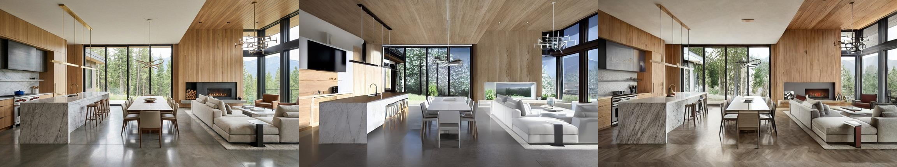
*Left: original. Middle: Method A (edges only), where the sofa and chairs turned white and the fireplace became a window. Right: Method B (edges + original photo), where the colors and the fireplace are kept and the floor became wood.*

## Key findings

- **Edges alone are not enough.** With ControlNet Canny only, colors and materials drifted (mean ΔE 21.9). Adding the original photo (img2img) cut this by 59%.
- **img2img has a trade-off.** The more it keeps the original, the weaker the prompt. The best balance was around strength 0.6 to 0.7.
- **Canny kept the design better than MLSD and Depth.** MLSD invented objects, Depth lost details.
- **Inpainting with a floor mask removed the trade-off.** Outside the floor almost nothing changed (ΔE 0.06), and the floor changed twice as much.
- **Metric choice matters.** CLIP scores the whole image, so it missed the local floor change; ΔE inside the mask measured it better.
- **The best method is now a live demo.** Anyone can [try it](https://huggingface.co/spaces/Mervecaliskan/keep-the-design): about 2 seconds per image on a free ZeroGPU Space.
- **fp16 is the big win, quantization is not (for SD 1.5).** fp16 halved memory and was 3.8× faster than fp32 at the same quality; LCM-LoRA was 4.3× faster again. 8-bit and 4-bit saved only 7–11% memory, unlike LLMs.
- **A paint code cannot be given as text.** Asking for a HEX code left the walls almost unchanged (ΔE 26.4) and a color name missed too (ΔE 19.9). Filling the walls with the exact color before generation brought them close (ΔE 3.9), and a simple color correction afterwards put all 15 cases under ΔE 5 (mean 2.1).
- **Automatic failure checks need human calibration.** On 25 labeled renders, the color detector was reliable (precision 1.00, recall 0.93), but the object detector raised 18 alarms for 8 real cases and the artwork detector missed 9 of 12 changed paintings.
- **Upscale faithfully by default.** Real-ESRGAN was the most faithful upscaler (best LPIPS 0.205) and 12× faster than the SD x4 upscaler, which looked sharper but invented details such as knitted cushion textures. PSNR even ranked plain bicubic first.
- **A bigger model is not better on every axis.** SD 1.5 kept edges more strictly (edge recall 0.96 vs 0.89), while SDXL at 1024 px kept colors and paintings better (ΔE 7.0 vs 9.5) and followed the prompt twice as well, at 2.7× the time and 3× the memory. At 768 px SDXL was worse than SD 1.5, so resolution matters as much as the model.
- **Still to video: more motion, less control.** Stable Video Diffusion kept the rooms recognisable and mostly moved the camera, but it already changed the first frame (ΔE 4.7 to 6.5) and its higher motion setting flickered twice as much as a depth-parallax baseline. My drift metric could not separate large camera moves from real design changes.

## Experiments

| # | Question | Notebook |
|---|---|---|
| 1 | Edges only vs edges + original photo, and the `strength` trade-off | [`interior_render_preservation.ipynb`](interior_render_preservation.ipynb) |
| 2 | Which ControlNet keeps the design best (Canny, MLSD, Depth), and simple speed settings | [`02_controlnet_types_and_speed.ipynb`](02_controlnet_types_and_speed.ipynb) |
| 3 | Change only the floor with a segmentation mask (inpainting) | [`03_inpainting_floor_mask.ipynb`](03_inpainting_floor_mask.ipynb) |
| 4 | What does it cost to run, and what is lost when it runs cheaper (fp32, fp16, 8-bit, 4-bit, LCM-LoRA, CPU offload) | [`04_quantization_modest_hardware.ipynb`](04_quantization_modest_hardware.ipynb) |
| 5 | Can the model paint a wall in an exact paint code (RAL / HEX)? | [`05_color_accuracy_ral_hex.ipynb`](05_color_accuracy_ral_hex.ipynb) |
| 6 | Can render failures be found automatically, and how well do the detectors agree with a human? | [`06_failure_set_triage.ipynb`](06_failure_set_triage.ipynb) |
| 7 | How do upscalers compare, and do they invent details? (bicubic, Real-ESRGAN, SD x4 upscaler, ESRGAN + SD refine) | [`07_upscaling.ipynb`](07_upscaling.ipynb) |
| 8 | Does a newer, larger model (SDXL) keep the design better than SD 1.5, and what does it cost? | [`08_sd15_vs_sdxl.ipynb`](08_sd15_vs_sdxl.ipynb) |
| 9 | Turning a still render into a short video: does the design stay the same over time? | [`09_still_to_video.ipynb`](09_still_to_video.ipynb) |

**Where the outputs are:**

| Folder | Outputs of |
|---|---|
| [`results/`](results/) | Experiment 1 (Method A vs B, strength sweep) |
| [`exp2/`](exp2/) | Experiment 2 (ControlNet types, speed) |
| [`exp3/`](exp3/) | Experiment 3 (floor mask, inpainting) |
| [`exp4/`](exp4/) | Experiment 4 (fp16, quantization, LCM, offload) |
| [`exp5/`](exp5/) | Experiment 5 (RAL / HEX wall colors) |
| [`exp6/`](exp6/) | Experiment 6 (failure set, detectors, human labels) |
| [`exp7/`](exp7/) | Experiment 7 (upscaling) |
| [`exp8/`](exp8/) | Experiment 8 (SD 1.5 vs SDXL) |
| [`exp9/`](exp9/) | Experiment 9 (still to video) |
| [`app/`](app/) | The Gradio demo and its screenshots |

Setup for Experiments 1 to 7: Stable Diffusion 1.5 + ControlNet, float16, free Colab T4 GPU, 768×432 images, 25 steps, fixed seed (42). One prompt for all methods, so the comparison is fair.

## How I measure

| Metric | What it tells | Better |
|---|---|---|
| **SSIM** | How similar the structure is (0 to 1) | higher |
| **Edge recall** | Share of the original edges (walls, windows, furniture) that are still in the render | higher |
| **Line recall** | Share of the original *straight* lines that are still in the render (Experiment 2) | higher |
| **Mean ΔE (CIEDE2000)** | Average color change per pixel in CIELAB space. ΔE < 2 is hard to see, ΔE > 10 is a clear change | lower |
| **ΔE outside / inside the mask** | Color change outside the floor (should be 0) and on the floor (the requested change) (Experiment 3) | lower / higher |
| **CLIP score gain** | How much more the render matches *"a room with a light oak wooden floor"* than the original photo does | higher |
| **Sec/image, peak GPU memory** | Speed and memory on a free T4 GPU (Experiment 2) | lower |
| **ΔE to target color** | Distance between the mean wall color and the requested paint color (Experiment 5) | lower |
| **Hit rate** | Share of room × color cases with ΔE to target below 5 (Experiment 5) | higher |
| **PSNR, LPIPS** | PSNR: pixel-level closeness to the real image. LPIPS: how different the image *looks*, measured by a neural network trained on human judgments (Experiment 7) | higher / lower |
| **Sharpness ratio** | Sharpness of the result divided by the sharpness of the real image (Laplacian variance); 1.0 = as sharp as reality (Experiment 7) | close to 1 |
| **Precision / recall of a detector** | Precision: share of its alarms that were real failures. Recall: share of the real failures it caught (Experiment 6, against my labels) | higher |

## Results

### Experiment 1a: Method A vs Method B (3 rooms)

| Method | What the model gets | SSIM ↑ | Edge recall ↑ | Mean ΔE ↓ |
|---|---|---|---|---|
| A: Canny only | Only the edge lines of the room | 0.354 | 0.890 | 21.9 |
| B: Canny + img2img (strength 0.6) | The edge lines **and** the original photo | **0.567** | **0.934** | **8.9** |

Method B was better on every metric and on every room. Adding the original photo cut the color change by about **59%** and kept **93%** of the original edges.

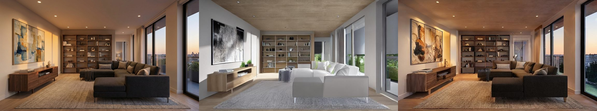
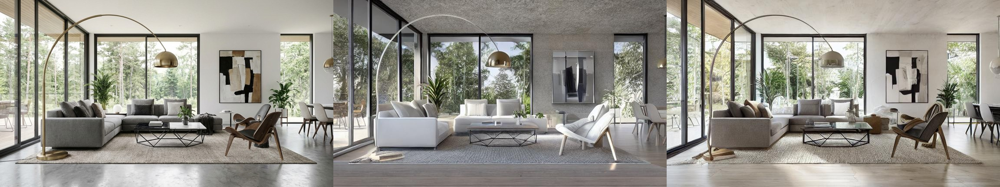

### Experiment 1b: The strength trade-off

Method B has a cost: the more it keeps the original, the weaker the prompt. I tested `strength` from 0.4 to 0.8.

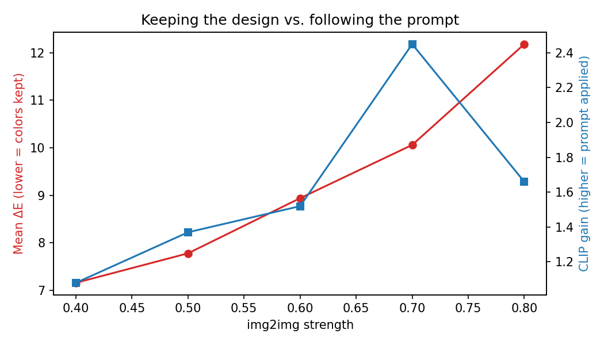

| Strength | Mean ΔE ↓ | CLIP gain ↑ |
|---|---|---|
| 0.4 | **7.2** | 1.08 |
| 0.5 | 7.8 | 1.37 |
| 0.6 | 8.9 | 1.52 |
| 0.7 | 10.1 | **2.45** |
| 0.8 | 12.2 | 1.66 |

- As strength goes up, colors drift more: mean ΔE rises steadily from 7.2 to 12.2.
- The prompt is applied better up to 0.7, but at 0.8 the score drops, because the model starts changing things it should not (the marble kitchen island turned into wood, paintings faded).
- **The best balance for this task is around strength 0.6 to 0.7.**

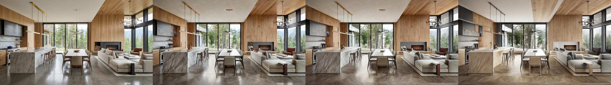
*Original | strength 0.4 | 0.6 | 0.8. At 0.8 the marble island becomes wood.*

### Experiment 2: Which ControlNet keeps the design best? Canny vs MLSD vs Depth

Same setup as Method B (img2img, strength 0.6). Only the control image changes.

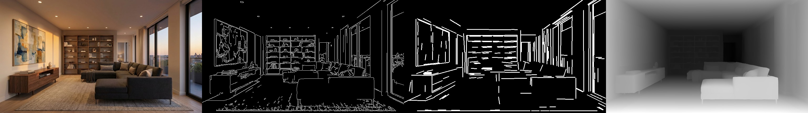
*What the model sees: original | Canny (all edges) | MLSD (straight lines only) | Depth*

| Control | SSIM ↑ | Edge recall ↑ | Line recall ↑ | Mean ΔE ↓ | CLIP gain ↑ | Sec/image |
|---|---|---|---|---|---|---|
| **Canny** | **0.566** | **0.939** | **0.785** | **8.9** | 1.52 | 5.4 |
| MLSD | 0.465 | 0.854 | 0.716 | 10.8 | **2.12** | 5.5 |
| Depth | 0.492 | 0.842 | 0.698 | 10.0 | 1.90 | 5.6 |

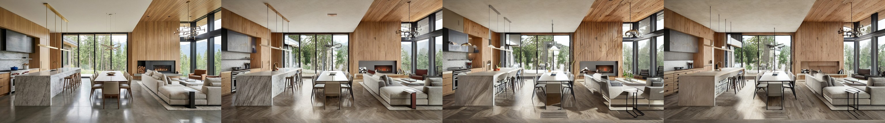
*Original | Canny | MLSD | Depth. With MLSD and Depth, the marble island turns into wood and the fireplace changes.*

- Against my expectation, **Canny kept the design best on every metric**, even on straight-line recall, where MLSD should have had an advantage.
- **MLSD invented objects** where there were no straight lines (a floor lamp, a pouf), because curved objects like the arc lamp are missing from its map.
- **Depth kept the layout but lost details**: a fireplace disappeared and a painting became a grid of frames. A depth map shows *where* a wall is, not *what* is on it.
- MLSD and Depth applied the prompt more, because they control the image less: the same trade-off as in Experiment 1.

**Speed and memory (one room):**

| Setting | Sec/image | Mean ΔE ↓ |
|---|---|---|
| Baseline (25 steps) | 5.7 | 7.8 |
| 15 steps | **3.8** (33% faster) | 7.9 |
| Attention slicing | 8.4 (47% slower) | 7.8 |

- 15 steps gave almost the same quality in a third less time.
- Attention slicing saved no memory here, because PyTorch 2 already uses memory-efficient attention (SDPA). It only helps on smaller GPUs or larger images, so an optimisation should be measured, not assumed.

### Experiment 3: Change only the floor with a segmentation mask

A segmentation model (SegFormer, trained on ADE20K) finds the floor. **Method C** repaints only this mask with Canny ControlNet and puts the original pixels back everywhere else.

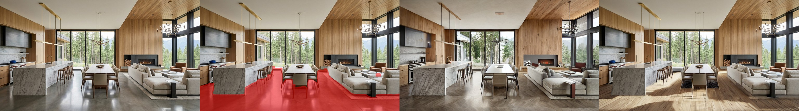
*Original | floor mask (red) | Method B (img2img) | Method C (inpainting)*

| Method | ΔE outside ↓ | SSIM outside ↑ | Edge recall outside ↑ | ΔE inside (floor change) ↑ | CLIP gain ↑ |
|---|---|---|---|---|---|
| B: img2img | 8.9 | 0.565 | 0.941 | 8.9 | **1.52** |
| **C: inpainting** | **0.06** | **0.997** | **0.992** | **16.6** | 0.82 |

- **Inpainting removed the trade-off.** Outside the floor almost nothing changed (ΔE 0.06, far below the visible limit of about 2), and the paintings stayed for the first time. The floor itself changed about twice as much as with Method B.
- **CLIP was misleading here.** It scored Method C lower, although its floors are clearly more wooden. CLIP looks at the whole image, so Method B's wooden ceiling raised its score. For local edits, ΔE inside the mask is a better measure.
- SegFormer found the floor well and left out the rugs. Thin objects that touch the floor, like chair legs and the lamp base, are partly inside the mask.

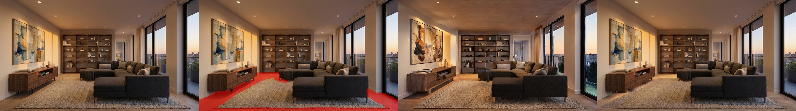
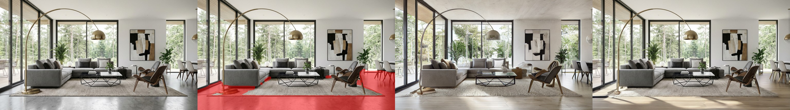

### Experiment 4: Running it cheaper: fp16, quantization, LCM and offload

The same render as Method B (3 rooms), run in six ways on a free T4 GPU.

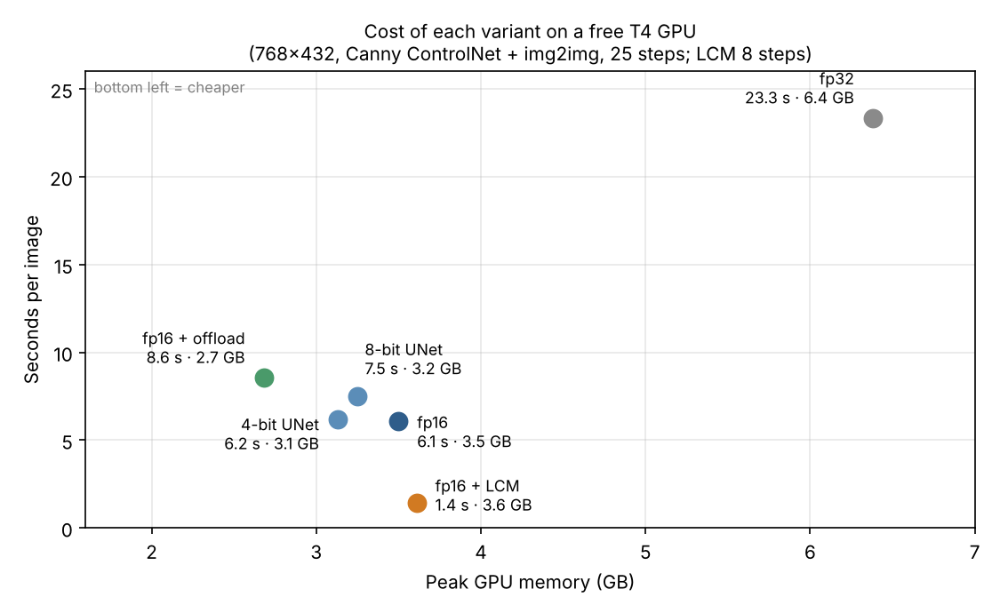

| Variant | Peak memory | Sec/image | ΔE vs fp16 ↓ | ΔE to original ↓ | Edge recall ↑ |
|---|---|---|---|---|---|
| fp32 | 6.38 GB | 23.3 | 10.2 | 8.7 | 0.935 |
| **fp16** | 3.50 GB | 6.1 | 0 | 8.9 | 0.939 |
| 8-bit UNet | 3.25 GB | 7.5 | 1.6 | 9.0 | 0.937 |
| 4-bit UNet | 3.13 GB | 6.2 | 2.1 | 8.9 | 0.931 |
| **fp16 + LCM-LoRA** (8 steps) | 3.61 GB | **1.4** | 8.9 | **8.5** | **0.950** |
| fp16 + CPU offload | **2.68 GB** | 8.5 | 0 | 8.9 | 0.939 |

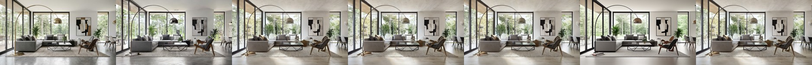
*Original | fp32 | fp16 | 8-bit | 4-bit | LCM | offload*

- **fp16 is the big win:** half the memory and 3.8× faster than fp32, with the same design preservation, because the T4's tensor cores work in fp16.
- **My first quality metric was wrong.** Every fp16-based variant was equally far from fp32 (ΔE ≈ 10), even plain fp16: tiny rounding differences grow over 25 denoising steps into a different but valid image. Comparing against fp16 showed the real effect of quantization.
- **Quantization barely helps for SD 1.5.** 8-bit and 4-bit give almost the same image as fp16 (ΔE 1.6 and 2.1) but save only 7–11% memory, and 8-bit is slower. bitsandbytes quantizes only the UNet's linear layers; the ControlNet, text encoder, VAE, convolutions and activations stay in fp16. In my thesis LLMs almost all weights are linear, which is why quantization helped much more there.
- **LCM-LoRA is the fastest:** 1.4 s per image with no loss in design preservation. It is a different image from the 25-step render, not a worse one.
- **CPU offload needs the least GPU memory** (2.7 GB peak) and gives exactly the same image as fp16, but is 40% slower.
- **Choice:** always fp16; LCM-LoRA for speed; CPU offload for a small GPU.

### Experiment 5: Hitting an exact paint color (RAL and HEX codes)

Architects order paint by code. If a user asks for *"walls in RAL 7016"*, the render should show that color, not just "some grey". SegFormer finds the walls, and each room's walls are repainted in 5 RAL colors (3 rooms × 5 colors = 15 cases) with four methods:

- **A: color name** in the prompt (*"walls painted in anthracite grey"*), walls repainted from scratch
- **B: HEX code** in the prompt (*"walls painted in color #383E42"*)
- **C: color-filled start:** the walls are filled with the exact color first, then the model adds light and texture (strength 0.6)
- **D: C + correction:** the mean wall color of C is shifted to the target in CIELAB; each pixel keeps its difference from the mean, so shading and texture stay

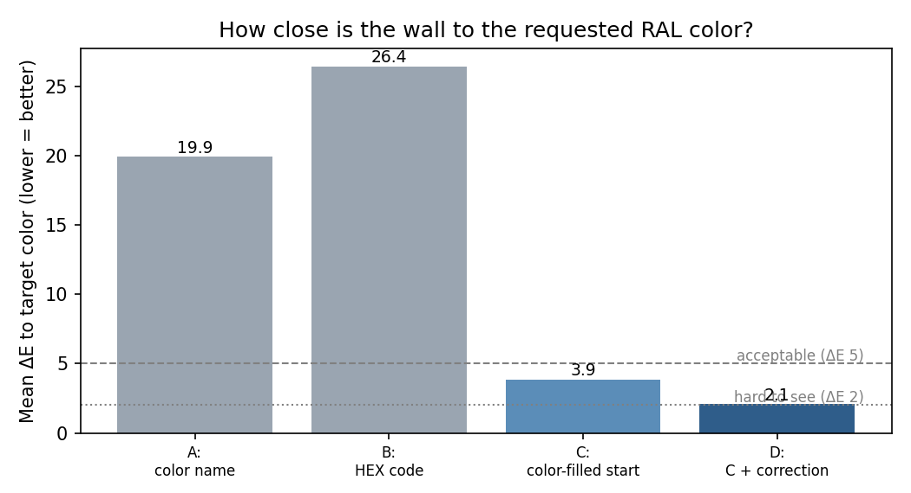

| Method | ΔE to target ↓ | Δab (hue/chroma) ↓ | Hit rate (ΔE < 5) ↑ | ΔE outside the walls ↓ |
|---|---|---|---|---|
| A: color name | 19.9 | 19.8 | 0 / 15 | 0.17 |
| B: HEX code | 26.4 | 25.2 | 0 / 15 | 0.17 |
| C: color-filled start | 3.9 | 4.6 | 12 / 15 | 0.17 |
| **D: C + correction** | **2.1** | **2.6** | **15 / 15** | 0.17 |

*RAL 7016 Anthracite grey in the warm-lit room: swatch | original | A | B | C | D. A and B barely change the walls (ΔE 21.4 and 30.0); C and D are close to the target (ΔE 3.0 and 2.2).*

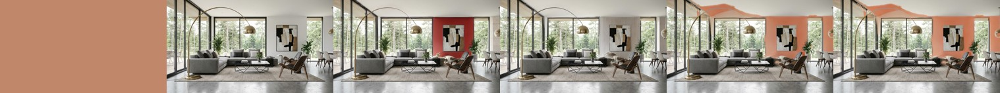
*RAL 3012 Beige red: A paints a saturated red patch, B changes nothing, C and D hit the color (here C, ΔE 1.7, was even closer than D, ΔE 2.0). The wall mask spilled onto the ceiling, so the ceiling was repainted too.*

- **The model does not understand color codes.** With a HEX code the walls mostly kept their original color, and in one room a green code produced red patches. It reads `#89AC76` as text, not as a color.
- **A color name gets only the direction.** No case came within ΔE 5, parts of the wall often stayed unpainted, and *"beige red terracotta"* became a saturated red.
- **The color has to be given as pixels.** Starting from walls filled with the exact color (C) put 12 of 15 cases under ΔE 5. All 3 misses were in the open-plan room, where the wall mask also covered wood paneling and parts of the ceiling (mean ΔE 5.6 there, 3.0 in the other two rooms).
- **A cheap correction closes the gap.** Shifting the mean color (D) put all 15 cases under ΔE 5 and most near the hard-to-see level (ΔE 2). This is a post-processing step of a few lines, with no extra model. It helped most where C was furthest off (open-plan room: 5.6 → 1.8); in one case (room 3, beige red) C was already closer than D.
- **Honest note on D:** the metric compares the mean wall color with the target, and D moves exactly this mean, so its low ΔE is partly guaranteed by design. It shows that a simple correction is enough to hit the code, not that the image looks more realistic; that needs a separate check, such as human ratings.

### Experiment 6: A failure set and automatic triage

In the earlier experiments I found failures **by looking**. A product team needs this automatically: every time a model or setting changes, run a fixed set of renders and see which failures got better or worse. I built such a check and tested it against my own judgment.

- **Failure set:** 5 rooms × 5 settings that fail in different ways (`canny_only`, `img2img` at strength 0.5 / 0.7 / 0.9, `inpaint_floor`) = 25 renders.
- **Detectors:** one per failure type: color shift (ΔE), lost structure (edge recall), bent lines (line recall), window and artwork changes (IoU of SegFormer masks), invented or removed objects (object classes that appear or disappear) and layout changes.
- **Human labels:** I looked at every render next to its original at full size and marked the failures I could see.

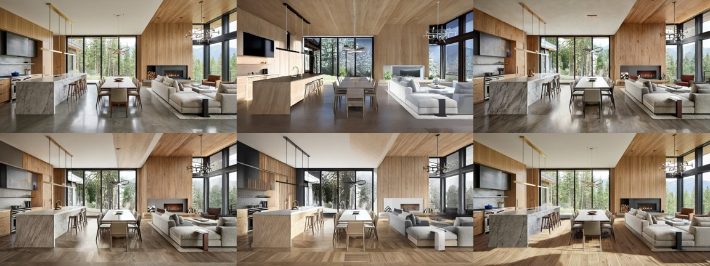
*Open-plan room. Top: original | canny_only | img2img 0.5. Bottom: img2img 0.7 | img2img 0.9 | inpaint_floor. The marble island turns into wood as strength rises, while inpaint_floor changes only the floor.*

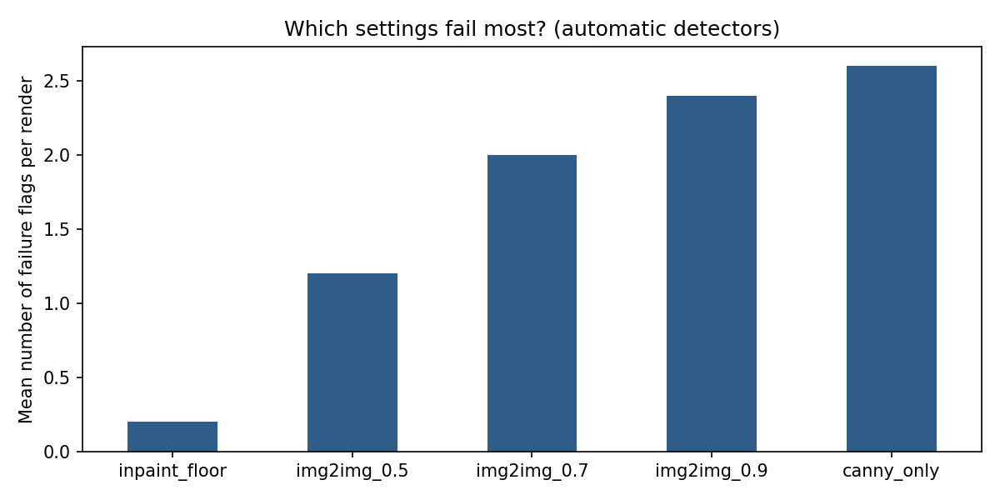

**The detectors ranked the settings correctly.** `inpaint_floor` had the fewest flags (0.2 per render) and `canny_only` the most (2.6), the same order I found by looking in Experiments 1 to 3.

**But single failure types were not equally reliable:**

| Detector | Failures I saw | Alarms | Both | Precision | Recall |
|---|---|---|---|---|---|
| **Color shift** | 15 | 14 | 14 | **1.00** | **0.93** |
| **Lost structure** | 1 | 1 | 1 | 1.00 | 1.00 |
| Invented or removed objects | 8 | 18 | 8 | 0.44 | 1.00 |
| Artwork changed | 12 | 5 | 3 | 0.60 | **0.25** |
| Window changed | 1 | 0 | 0 | – | 0.00 |
| Bent lines | 0 | 3 | 0 | 0.00 | – |
| Layout changed | 0 | 1 | 0 | 0.00 | – |

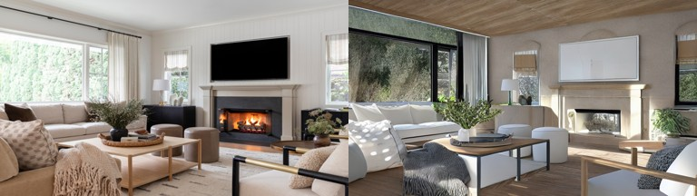
*Fireplace room, `canny_only`: the TV became a white panel, a new window appeared and the rug disappeared. The detectors caught the color shift, the panel and the rug, but missed the window and reported a layout change that did not happen.*

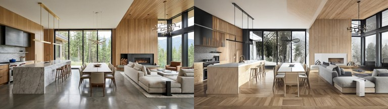
*Open-plan room, `img2img_0.9`: the marble island turned into wood and the fireplace into a white box. The object detector reported "kitchen island removed": the right render, but the wrong reason.*

- **Color shift can be trusted:** no false alarms, and the only miss was a ceiling that turned into wood while the whole-image ΔE (8.9) stayed under the threshold of 10.
- **The object detector is an alarm, not an answer.** It never missed a real case, but more than half of its alarms were false. The segmentation model gives the same object different names in the two images: one painting was called "mirror" in the original and "painting" in the render. In 4 of its 8 correct alarms it named the wrong object.
- **The artwork detector gives false confidence.** It caught only 3 of 12 changed paintings, because it checks *where* a painting is, not *what* is in it. A painting that stays in place but changes its content passes.
- **The overall agreement (85%) hides all of this,** because most render × failure pairs are "no failure" for both me and the detectors. Per-type precision and recall tell the real story.
- **Labeling needs care too.** My first labels from small grids changed for 9 of the 25 renders after I checked them at full size (a ceiling turned into wood, an armchair became a table). Small changes in shape (leaves, vases) were not counted.
  

### Experiment 7: Upscaling without changing the design

After a render is made, architects often want a bigger, sharper version for print or a presentation. A strong upscaler can **invent details**, and for an architect an invented detail is a design change.

To measure this fairly, I used sharp interior photos (1280×768) as the **ground truth**, shrank them 4× to 320×192, and let each method bring them back. Four methods, one from each main family of upscalers plus a common hybrid:

- **A: Bicubic:** classic resizing, no AI
- **B: Real-ESRGAN:** a GAN trained to sharpen photos
- **C: SD x4 upscaler:** a diffusion model made for 4× upscaling
- **D: Real-ESRGAN + SD refine:** B, then a light Stable Diffusion img2img pass (strength 0.25), the "creative upscale" many render tools use

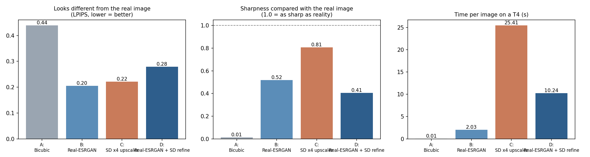

| Method | PSNR ↑ | SSIM ↑ | LPIPS ↓ | ΔE ↓ | Sharpness ratio | Sec/image | Peak memory |
|---|---|---|---|---|---|---|---|
| A: Bicubic | **25.2** | **0.744** | 0.439 | **2.8** | 0.01 | 0.01 | 4.0 GB |
| **B: Real-ESRGAN** | 24.6 | **0.744** | **0.205** | 3.6 | 0.52 | 2.0 | 4.5 GB |
| C: SD x4 upscaler | 22.5 | 0.645 | 0.222 | 4.7 | **0.81** | 25.4 | 7.1 GB |
| D: Real-ESRGAN + SD refine | 21.8 | 0.648 | 0.279 | 5.6 | 0.41 | 10.2 | 6.4 GB |

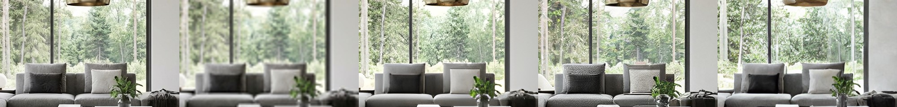
*Zoomed crop at full size: ground truth | A | B | C | D. Bicubic is blurry, Real-ESRGAN keeps the cushions as they are, the SD x4 upscaler gives them a knitted texture that was never there, and the refine step leaves the cushions but adds plaster texture to the wall.*

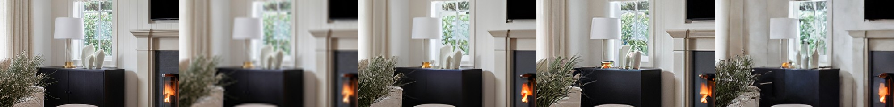
*Ground truth | A | B | C | D. The white sculptures stay the same with Real-ESRGAN; the diffusion methods add a golden object (C) or turn them into bottles (D).*

- **Real-ESRGAN is the best default:** the best LPIPS and SSIM, nothing invented, 2 s per image with 4.5 GB. Fine details look slightly smoothed.
- **The SD x4 upscaler is the sharpest, but invents details:** knitted cushion textures, new objects next to sculptures, changed flowers in paintings. It is also 12× slower than Real-ESRGAN and needs 7.1 GB.
- **The refine step was the worst on every quality metric:** in all five rooms it added a plaster-like texture to plain walls and ceilings and changed small objects.
- **PSNR was misleading:** it ranked the blurry bicubic result first, because blur stays close to the average pixel value.
- **No metric caught the invented details.** I expected a sharpness ratio above 1 to reveal invented texture, but no method reached the real image's sharpness. Only the zoomed crops showed what changed, the same lesson as Experiment 6.

### Experiment 8: SD 1.5 vs SDXL

All experiments above used **Stable Diffusion 1.5** (2022, trained at 512 px). Current render tools use newer, larger models. **SDXL** (2023) has a UNet about three times larger, two text encoders and was trained at 1024 px. Does it keep the design better with the same setup (Canny ControlNet + img2img, strength 0.6), and what does it cost on a free T4?

- **A: SD 1.5 at 768×432:** the setup of my earlier experiments
- **B: SDXL at 768×432:** same size, different model (the effect of the model)
- **C: SDXL at 1024×576:** close to SDXL's native size (the effect of resolution)

All outputs were resized to 768×432 before measuring, so every variant is compared with the same original. Five rooms, same prompt, seed, steps and ControlNet scale.

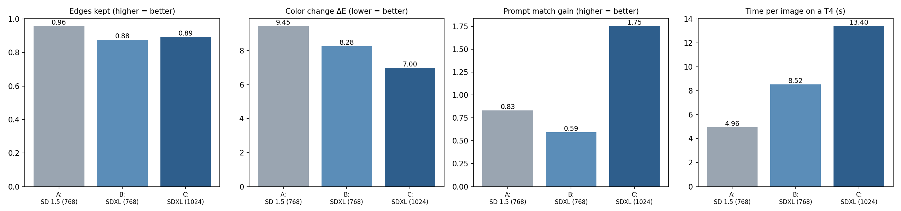

| Variant | Edge recall ↑ | SSIM ↑ | ΔE ↓ | CLIP gain ↑ | Sec/image | Peak memory |
|---|---|---|---|---|---|---|
| A: SD 1.5 (768) | **0.957** | 0.538 | 9.5 | 0.83 | **5.0** | **3.8 GB** |
| B: SDXL (768) | 0.876 | 0.624 | 8.3 | 0.59 | 8.5 | 10.5 GB |
| **C: SDXL (1024)** | 0.894 | **0.689** | **7.0** | **1.75** | 13.4 | 11.1 GB |

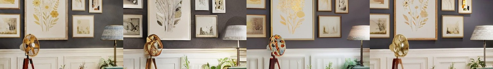
*Original | SD 1.5 | SDXL at 768 | SDXL at 1024. SD 1.5 turned the sunflower drawing into a branch; SDXL at 1024 kept it closest to the original.*

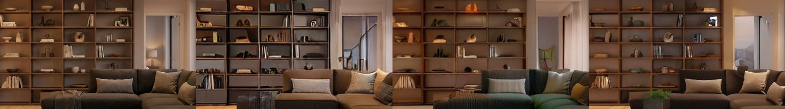
*SD 1.5 keeps the shelf lines but changes the objects and turns the door into a staircase; SDXL at 1024 keeps the objects closest, but adds a plant to the table.*

- **SD 1.5 keeps geometry more strictly.** It had the best edge recall in all five rooms, because its Canny ControlNet follows the edge map very closely. But it changed colors and small objects most.
- **SDXL at its native size keeps colors, objects and artwork better** (best SSIM and ΔE) and followed the prompt twice as well. It still invented some things (a plant on a table, a dark cushion turned green), and in one room it did not change the floor at all.
- **SDXL below its native size lost its advantage:** at 768 it was worse than SD 1.5 on edges and prompt match.
- **The cost:** SDXL at 1024 was 2.7× slower and needed 3× the memory, using most of the T4's 15 GB.
- **What "better" means depends on the task:** lines and layout favour SD 1.5; materials, colors and artwork favour SDXL.

### Experiment 9: From a still render to a short video

Render tools now turn a still render into a short clip with a slow camera move. Video models generate many connected frames, and the risk is that the design **drifts** over time. I turned three rooms into 25-frame clips (about 3.5 s) in three ways:

- **A: Depth parallax:** no generative model; Depth Anything V2 estimates depth and the image is warped so near objects move more than far ones
- **B: Stable Video Diffusion (img2vid-xt), low motion** (`motion_bucket_id` 40)
- **C: Stable Video Diffusion, default motion** (`motion_bucket_id` 127)

Because the camera moves, frames cannot be compared pixel by pixel. I estimated the motion between frames with optical flow, warped the frames back onto each other, and measured flicker (change between neighbouring frames that motion does not explain) and drift (change from the first to the last frame).

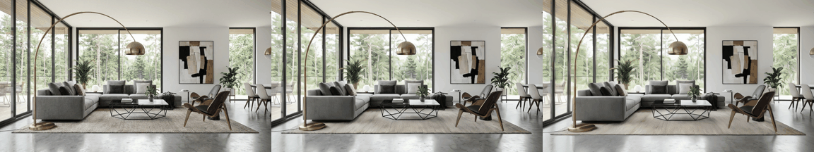
*The same render as a video: depth parallax | SVD low motion | SVD default motion. With the default motion, the camera moves strongly towards the sofa.*

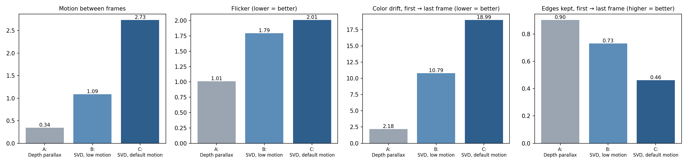

| Method | Motion (px/frame) | Flicker ΔE ↓ | Drift ΔE ↓ | Drift edge recall ↑ | First frame ΔE ↓ | Sec/video | Peak memory |
|---|---|---|---|---|---|---|---|
| A: Depth parallax | 0.34 | **1.0** | **2.2** | **0.90** | **0** | **0.8** | – |
| B: SVD, low motion | 1.09 | 1.8 | 10.8 | 0.73 | 4.7 | 392 | 9.1 GB |
| C: SVD, default motion | **2.73** | 2.0 | 19.0 | 0.46 | 6.5 | 387 | 9.1 GB |

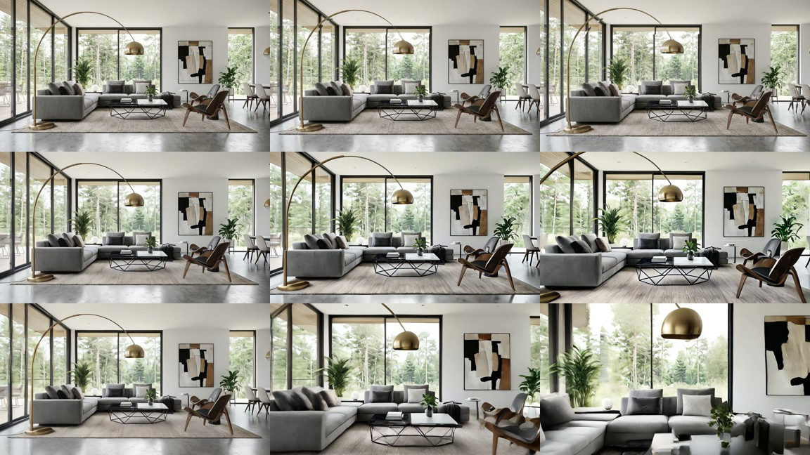
*Rows: A, B, C. Columns: first, middle and last frame. With the default motion, SVD moves the camera strongly towards the sofa; the lamp, the painting and the furniture stay recognisable.*

- **SVD kept the rooms recognisable.** Looking at the frames, most of the change is camera movement: the lamp, the painting, the marble island and the furniture stay the same type and in the same place. Smaller changes appear as the camera moves, such as the shape of a sofa and the objects on a shelf.
- **It already changes the first frame** (ΔE 4.7 to 6.5): the clip does not start exactly from the user's render.
- **More motion means more flicker:** the default motion setting moved 2.5× more than low motion and flickered twice as much as the parallax baseline.
- **My drift metric was not reliable for large camera moves.** Drift ΔE (19.0) and edge recall (0.46) for the default motion look like strong design changes, but the frames show that the camera moved a lot and parts of the room left the frame, which optical flow cannot align. The numbers mix camera motion and design change, so they need the frames next to them.
- **Depth parallax is faithful and fast but barely moves** (0.34 px per frame, 0.8 s per clip): with my settings the camera move is too small to feel like a video.
- **The cost:** each SVD clip took about 6.5 minutes on a T4 with CPU offload and 9.1 GB of GPU memory.

## Live demo

The method from Experiment 3 runs as a [Gradio app on Hugging Face Spaces](https://huggingface.co/spaces/Mervecaliskan/keep-the-design). Upload a photo, choose a floor (oak, walnut, parquet, marble, concrete, terracotta) or describe your own, and the app shows the floor mask, the result and the measurements.

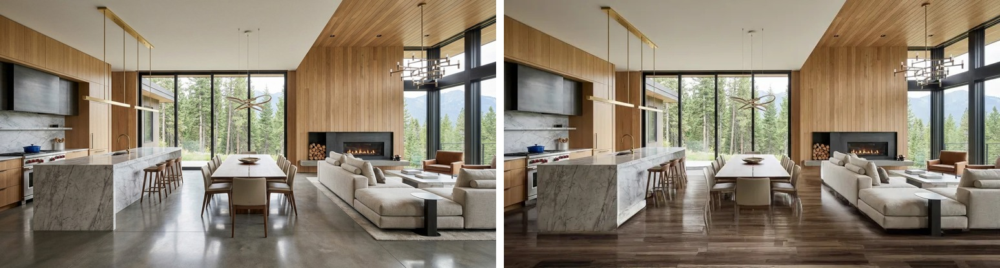
*Before | after: concrete floor changed to dark walnut. Outside the floor: ΔE 0.05 (nothing changed). On the floor: ΔE 19.3. Time: 2 s on GPU.*

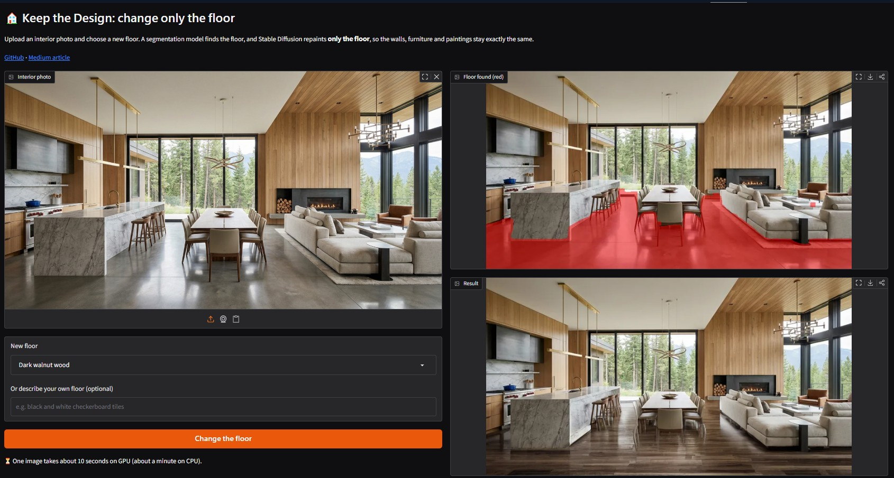
*The app: upload a photo, choose a floor, see the floor mask and the result.*

- **Pipeline:** SegFormer finds the floor → Stable Diffusion 1.5 + Canny ControlNet repaints only the floor → the original pixels are put back outside the mask.
- **Runs on free hardware:** on a ZeroGPU Space it uses 25 steps (about 2 s per image). Without a GPU it switches to LCM-LoRA, which needs only 6 steps, so it still runs on a CPU.
- Code: [`app/app.py`](app/app.py)

## What went wrong and what I learned

- **Problem:** with edges only, colors and materials drifted (ΔE ≈ 22): dark sofas turned white, paintings lost their colors, a fireplace became a window, and "wooden floor" was applied to the ceiling in one room.
- **Cause:** Canny edges carry no color information, so the model invents the colors.
- **Fix:** add the original photo as img2img input. Result: ΔE ≈ 9, edge recall 93%.
- **New problem:** the prompt becomes weaker (daylight was not applied, a painting changed).
- **Measured the trade-off:** the best balance was around strength 0.6 to 0.7.
- **Tried other controls:** MLSD and Depth control the image less, so they follow the prompt more but invent or lose details. For keeping a design, Canny was the safest choice.
- **Solved with a mask:** inpainting with a segmentation mask kept everything outside the floor (ΔE 0.06) and changed the floor twice as much. The best way to keep a design is to decide *where* the model may change the image.
- **Metric choice matters:** CLIP scores the whole image and missed the local floor change. A region-based metric (ΔE inside the mask) told the real story.
- **Text is not enough for exact colors:** a prompt can describe a color but not hit a paint code. Giving the color as pixels and correcting it afterwards worked (Experiment 5).
- **Automatic checks must be checked too:** a detector can rank settings correctly and still be wrong on most single cases. Comparing it with human labels showed which detectors to trust (Experiment 6).
- **Sharper is not better:** the sharpest upscaler invented details that no metric caught; a faithful default and zoomed visual checks matter more (Experiment 7).
- **A newer model is a trade-off, not an upgrade:** SDXL kept colors and artwork better but edges less strictly, cost 3× the memory, and needed its native resolution to help at all (Experiment 8).
- **A metric that mixes two things cannot judge either:** for video, my drift numbers mixed camera motion with design change; the frames showed that SVD mostly moved the camera (Experiment 9).
- **From notebook to app:** the code that ran in Colab failed on Hugging Face because `torchvision` was missing. A different environment needs its own dependency check.

## Limits

- Only 3 rooms and one seed. The method rankings and the CLIP peak at 0.7 need more images and seeds to confirm.
- In Experiments 1 and 2, mean ΔE is measured on the whole image, so it also counts the floor, which I changed on purpose. Experiment 3 measures inside and outside the floor separately.
- Experiment 2 used strength 0.6 for all control types, a value chosen for Canny in Experiment 1. MLSD and Depth may work better at a different strength.
- In Experiment 3 the result depends on the mask: thin objects on the floor can change because they are inside it. ΔE outside is not exactly 0 because of the soft mask edge and JPEG compression.
- One room already had a wooden floor, which lowers its CLIP gain.
- In Experiment 5, RAL→sRGB values are approximations and a wall under real light is not a paint chip, so ΔE also includes lighting. Two rooms have little visible wall (17%), the wall mask covered wood paneling in one room and spilled onto the ceiling in another, and the realism of method D was not rated.
- In Experiment 6, the human labels are from one person (me), on 25 renders from five rooms and one seed. The detector thresholds are first guesses, and ΔE on the whole image also counts the floor, which img2img changes on purpose.
- In Experiment 7, the low-resolution inputs were made by shrinking real photos with bicubic resizing; real renders can have other kinds of blur and noise. The diffusion methods were run with one prompt and one setting.
- In Experiment 8, the ControlNet scale (1.0) and strength (0.6) were chosen for SD 1.5 in Experiment 1; the SDXL Canny ControlNet may follow edges more closely at a higher scale, so part of the edge gap could be a tuning effect. Measuring at 768×432 hides some of SDXL's extra detail.
- In Experiment 9, three rooms and one seed were used. Optical flow fails on large camera moves, plain walls and reflections, so the drift numbers overstate design change for SVD with high motion. SVD chooses its own camera motion, so the methods do not move the camera in the same way, and the parallax setting moved the camera only slightly.
- Peak GPU memory (6.5 GB) includes all models loaded in Experiment 2 (three ControlNets, the depth model and CLIP), so a single pipeline needs less. Speed results are from one room.

All results are reproducible: running the notebooks again with seed 42 gives the same images and numbers.

## Next steps

- A smaller mask margin, or excluding thin objects like chair legs from the mask.
- Region-based prompt metrics, for example CLIP on the floor crop only.
- More rooms and seeds, with confidence intervals.
- Human ratings of realism for the color methods, and a correction that adapts to uneven light instead of shifting only the mean.
- Better detectors for Experiment 6: compare the *content* of each painting (color or CLIP similarity inside its mask) instead of its position, and merge segmentation classes that are often confused (painting / mirror, sofa / armchair).

## How to run

**Demo:** open the [Hugging Face Space](https://huggingface.co/spaces/Mervecaliskan/keep-the-design), no setup needed.

**Notebooks:**
1. Open a notebook in Google Colab.
2. *Runtime → Change runtime type → T4 GPU*.
3. Run the cells in order and upload your own interior images when asked.

**App locally:** `pip install -r app/requirements.txt` and `python app/app.py` (a GPU is recommended).

**Tech:** Python, PyTorch, SDXL, Stable Video Diffusion, optical flow (OpenCV), Real-ESRGAN (spandrel), LPIPS, Hugging Face `diffusers` and `transformers`, Stable Diffusion 1.5, ControlNet (Canny, MLSD, Depth), SegFormer, Depth Anything V2, CLIP, LCM-LoRA, Gradio, Hugging Face Spaces (ZeroGPU), bitsandbytes, OpenCV, scikit-image, pandas, matplotlib.

## Author

**Merve Caliskan** · [GitHub](https://github.com/Mervecaliskann) · [LinkedIn](https://www.linkedin.com/in/mervecaliskann) · [Medium](https://medium.com/@mervcaliskaan)
