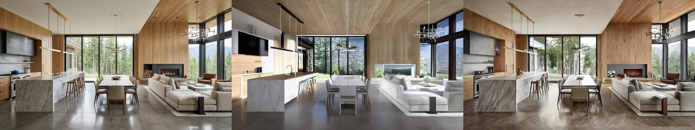
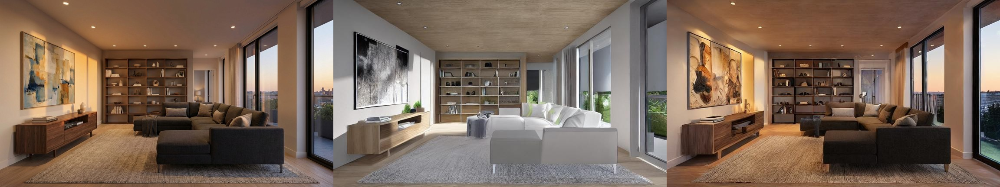
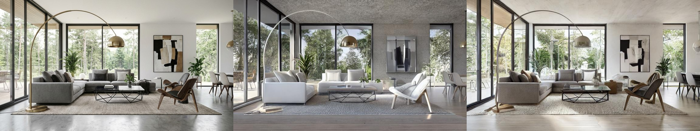
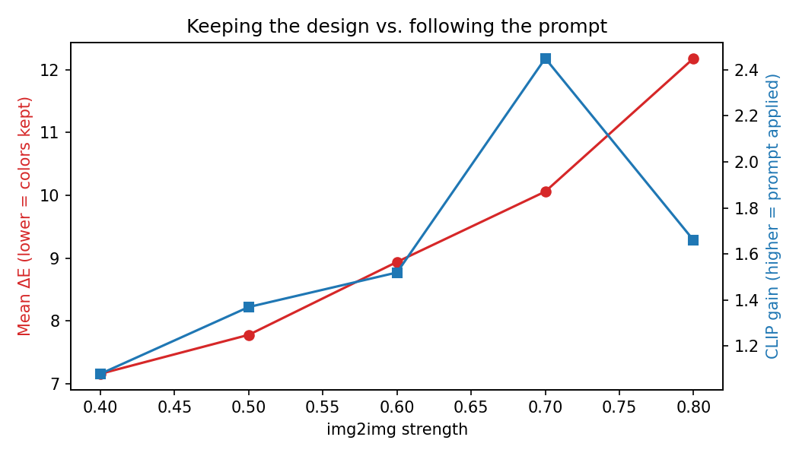
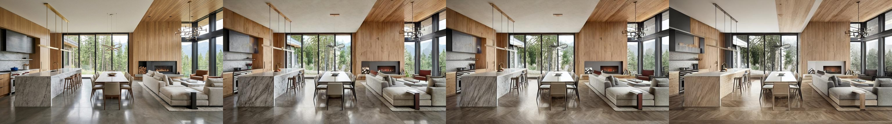

# Keeping the Design: Geometry and Material Preservation in AI Interior Renders

AI render tools turn an interior image into a photorealistic render. Architects want the render to **keep their design**: the same walls, windows, furniture and colors. A common failure is that the model changes things it should not change.

📝 **Read the full step-by-step write-up on Medium:** [Does the AI Keep Your Design?](https://medium.com/@mervcaliskaan/does-the-ai-keep-your-design-measuring-geometry-and-color-in-stable-diffusion-interior-renders-43260ec239d3)

In this project I ask for one change (*"light oak wooden floor"*) and measure how well two ControlNet methods keep everything else.

*Left: original. Middle: Method A (edges only), where the sofa and chairs turned white and the fireplace became a window. Right: Method B (edges + original photo), where the colors and the fireplace are kept and the floor became wood.*

## Methods

| Method | What the model gets |
|---|---|
| **A: Canny only** | Only the edge lines of the room (ControlNet Canny) |
| **B: Canny + img2img** | The edge lines **and** the original photo, with `strength` = how much may change |

Setup: Stable Diffusion 1.5 + ControlNet (Canny), float16, free Colab T4 GPU, 768×432 images, 25 steps, fixed seed (42). One prompt for all methods, so the comparison is fair.

## How I measure

| Metric | What it tells | Better |
|---|---|---|
| **SSIM** | How similar the structure is (0 to 1) | higher |
| **Edge recall** | Share of the original lines (walls, windows, furniture) that are still in the render | higher |
| **Mean ΔE (CIEDE2000)** | Average color change per pixel in CIELAB space. ΔE < 2 is hard to see, ΔE > 10 is a clear change | lower |
| **CLIP score gain** | How much more the render matches *"a room with a light oak wooden floor"* than the original photo does | higher |

## Results

### 1. Method A vs Method B (3 rooms)

| Method | SSIM ↑ | Edge recall ↑ | Mean ΔE ↓ |
|---|---|---|---|
| A: Canny only | 0.354 | 0.890 | 21.9 |
| B: Canny + img2img (strength 0.6) | **0.567** | **0.934** | **8.9** |

Method B was better on every metric and on every room. Adding the original photo cut the color change by about **59%** and kept **93%** of the original edges.

### 2. The strength trade-off

Method B has a cost: the more it keeps the original, the weaker the prompt. I tested `strength` from 0.4 to 0.8.

| Strength | Mean ΔE ↓ | CLIP gain ↑ |
|---|---|---|
| 0.4 | **7.2** | 1.08 |
| 0.5 | 7.8 | 1.37 |
| 0.6 | 8.9 | 1.52 |
| 0.7 | 10.1 | **2.45** |
| 0.8 | 12.2 | 1.66 |

- As strength goes up, colors drift more: mean ΔE rises steadily from 7.2 to 12.2.
- The prompt is applied better up to 0.7, but at 0.8 the score drops, because the model starts changing things it should not (the marble kitchen island turned into wood, paintings faded).
- **The best balance for this task is around strength 0.6 to 0.7.**

*Original | strength 0.4 | 0.6 | 0.8. At 0.8 the marble island becomes wood.*

## What went wrong and what I learned

- **Problem:** with edges only, colors and materials drifted (ΔE ≈ 22): dark sofas turned white, paintings lost their colors, a fireplace became a window, and "wooden floor" was applied to the ceiling in one room.
- **Cause:** Canny edges carry no color information, so the model invents the colors.
- **Fix:** add the original photo as img2img input. Result: ΔE ≈ 9, edge recall 93%.
- **New problem:** the prompt becomes weaker (daylight was not applied, a painting changed).
- **Measured the trade-off:** the best balance was around strength 0.6 to 0.7.
- **Weakest point:** paintings changed their content even at strength 0.4.

## Limits

- Only 3 rooms and one seed. The CLIP peak at 0.7 needs more images and seeds to confirm.
- Mean ΔE is measured on the whole image, so it also counts the floor, which I changed on purpose.
- One room already had a wooden floor, which lowers its CLIP gain.

All results are reproducible: running the notebook again with seed 42 gives the same images and numbers.

## Next steps

- **Inpainting with a floor mask**, so only the requested area can change, and measuring ΔE only outside the mask.
- A Depth ControlNet as a third method.
- More rooms and seeds, with confidence intervals.

## How to run

1. Open `interior_render_preservation.ipynb` in Google Colab.
2. *Runtime → Change runtime type → T4 GPU*.
3. Run the cells in order and upload your own interior images when asked.

**Tech:** Python, PyTorch, Hugging Face `diffusers` and `transformers`, Stable Diffusion 1.5, ControlNet, CLIP, OpenCV, scikit-image, pandas, matplotlib.

## Author

**Merve Caliskan** · [GitHub](https://github.com/Mervecaliskann) · [LinkedIn](https://www.linkedin.com/in/mervecaliskann) · [Medium](https://medium.com/@mervcaliskaan)
